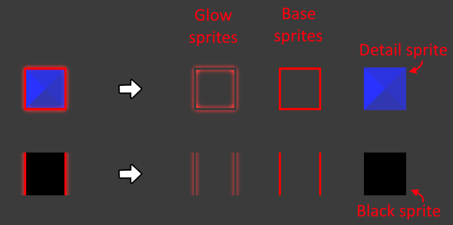
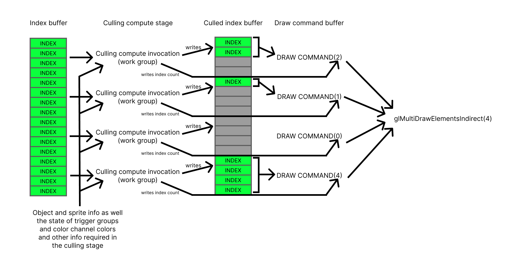

# Technical Explanation
Bismuth's rendering engine is completely seperate from how
Geometry Dash renders its levels. Bismuth's renderer is
ONLY concerned with rendering objects. Shader effects and
other stuff remain unaffected.

## 1 How does GD render objects?
### 1.0 Sprites and sprite types

Every object in GD consists of one or multiple sprites. But
there are types of sprites. A sprite can either be a **base** sprite,
**detail** sprite, **glow** sprite or **black** sprite.

Base and detail sprites are given the base and detail color
channel colors respectively.

Black sprites are always black no matter what.



<br>

Each sprite can be from one of the following spritesheets:
- `GJ_GameSheet` (most objects)
- `GJ_GameSheet02` (mostly portals, the coin and some rare objects)
- `GJ_GameSheetGlow` (all glow sprites)
- `FireSheet` (many animated objects)
- `ParticleSheet` (particle sprites)
- `PixelSheet` (pixel objects)

### 1.1 Sprite batches

To show objects on screen, GD adds these objects to **sprite batches**.
Sprite batches allow for faster **batched rendering** where you send
a whole bunch of sprites meshed together to the GPU and tell it to
render it instead of rendering the sprites individually.

However, one **single sprite** batch can ONLY contain sprites from
the **same spritesheet**! It can also ONLY have all of the sprites
be blending or not. You **cannot mix blending and non-blending
sprites** in a single sprite batch.

To fix this, GD has multiple sprite batches. Each for every spritesheet
and blending combination.

This however also causes a **second** problem. The order in which we
draw objects are now dependent on which order we draw the **sprite batches** in.
To fix this, RobTop added **ZLayer**.

Sprite batches are now created for every combination of **ZLayer**, **Spritesheet** and **Blending**. Sprite batches are ordered by ZLayer first,
then spritesheet, then finally blending.

### 1.2 Visibility checks

To ensure that GD does not draw objects that are offscreen. GD does
**visibility checks**.

It checks whether objects are on screen. If they are, their sprites are
added to their appropriate **sprite batch** to be sent to the GPU.
If they aren't, they are removed from their sprite batch. The act
of removing offscreen objects is also known as **culling**.

If GD finds an object to be visible. It also sets their sprites' appropriate
colors depending on color channel. For the bouncing audio object, it sets
the appropriate size. As well as for rotating objects like saws, it updates
their rotation for that frame.

Visibility checks are one of the slowest aspects of the game especially
if there are many objects on screen.

The game makes sure that objects far away from the screen are not even
checked for visibility. It does so by grouping objects into evenly
spaced chunks depending on its position. GD then only checks the objects
in the chunks that are visible on screen.

However, if a object moves across chunk boundaries. The object has to be
removed from the chunk it's was in and be added to the chunk it is in now.
This is a slow operation. This is one of the main reasons why move triggers
can be so slow.

Rotate triggers are especially slow because of GD's very "unconventional"
way of rotating objects. There is no reason why it has to be like that and
making it use simple rotation math instead would already make it run like 
5x faster.

## 2 How does Bismuth do it?

### 2.0 Simple overview

When starting a level, Bismuth gathers all info about objects and its
sprites that are required in the rendering. It also gathers other info
for rendering. And then sends it all to the GPU and loads it into
designated buffers (chunks of memory).

And every frame, Bismuth gathers all the color channel colors and send it
to the GPU. It also gathers info about movement triggers and sends
that to the GPU so that it can figure out where the objects would
be located now after having been moved by triggers.

Then then runs the compute shader on the GPU.

A compute shader is a piece of code that runs on the GPU to do data processing.
It takes advantage of the GPUs parallel design.

GPUs are designed to read a single instruction from a shader and apply it
to many, many pieces of data. A single GPU core handles a single piece of data and
GPUs can have 10,000s of such cores.

Bismuth's compute shader goes through every object and applies the movement
transforms to it. It finds the current position and checks if it's on screen.
If it is, figures out its color from the color channel buffer. It applies some
other specific transforms like rotation and such. And then it adds that object
to the batch for rendering. And by utilizing all your GPU cores, 10,000s of
objects can be processed on at the same time!

Compute shaders mostly read and write data to buffers. So, if we need to send
info to it or get info from it, it is in the form of buffers.

### 2.1 Sorted object batch

Object have to always be drawn in the correct order as in Vanilla. Since
objects can change blending over the course of a level, they can spontaneously
change ordering due to how GD handles sprites and sprite batches as explained in
[section 1.1](#11-sprite-batches).

Bismuth's compute shader needs one list of all sprites in the order that they are
drawn. Everytime blending changes, Bismuth generates a new list of objects
sorted depending on the blending states.

However, Bismuth makes sure to store that sorted list when blending changes
again so that it does not have to be regenerated once the blending states
changes back.

When generating that sorted object batch, Bismuth reorders all the sprites
into the correct layers (based on zlayer, spritebatch and now the new blending states) and sorts them.

For them to be processed by the compute shader, they will have to be divided
into work groups.

### 2.2 Work groups & draw commands

A work group is a single instance of a compute shader. One work group
runs on one GPU core and handle one piece of data at a time. For best
performance, the amount of work groups should equal 2.5x the amount
of GPU cores.

So, we figure out the number of work groups to use and we assign a number
of sprites to a work groups. Each work group then processes the sprites
assigned to it in the GPU.

It first finds the current position of the sprite by applying the group
movements (explained later). It checks if the position is on screen. If it
isn't on screen, it just skips that sprite and goes to the next one. If it
is, it then continues processing the object. Finding out its color, 
transformation and other info for render.

To find the color of the sprite. We know the sprite type (base, detail,
black, glow). We also know the base and detail color channel ids of
its parent object. We figure out the correct color channel and then
take appropriate color from the **color channel buffer**. This buffer
is sent every frame to the GPU and it contains a list of all the 1101
color channel colors.

Pulse group triggers are also applied here. They have to be applied for
every object which is why they can also be slow sometimes.

We also figure out how the sprite should be transformed and its opacity.
We finally store its color, transformation and opacity into the
**raw sprite buffer**. This buffer is then read by the rendering stage
to draw the sprites on screen.

Because of the fact that there may be a varying number of sprites to
be drawn. We also need to tell the GPU how many to draw. Bismuth allocates
one draw command for each work group. A draw command tells the rendering
stage how many sprites to render.

Each work group figures out how many of its sprites are on screen and writes
to its draw command how many sprites to draw. The rendering stage then goes
through each of the draw commands and draws its sprites.

Here is a more technical diagram I made a while ago which explains how
it does that:



### 2.3 Group combination states

Instead of storing the current transformation and alpha of every group
per group. It stores it per **group combination**. It stores it into
the **group combination state buffer**.

Bismuth goes through every object in the level and assigns every unique
combination of group ids a group combination id:

```
object 1 group ids: (1, 5, 7) <- group combination id 1
object 2 group ids: (1, 5)    <- group combination id 2
object 3 group ids: (1, 8)    <- group combination id 3
object 4 group ids: (1, 8)    <- group combination id 3
object 5 group ids: (1, 20)   <- group combination id 4
object 6 group ids: (1, 8)    <- group combination id 3
```

For every group combination, Bismuth stores its **current alpha**.
It fetches all the current group alpha values from the game's
code, combines them for every group combination and stores them
into the **group combination state buffer**.

Bismuth also stores a transformation matrix for every group combination.
This matrix says how much objects with that group combination have been
moved or transformed in any way by move/rotate/follow triggers.

Bismuth listens to any move/rotate/follow trigger actions in the game.
Then applies those transformations to its group combination states in
the group combination state buffer.

And now, in the list of object info we send to the compute shader,
we only store the group combination id per object. The compute shader can then based on that id find which group combination state to apply
to the sprites.

We also know the start positions of the sprites which is their position
at the start of the level. We apply the transformation matrix to their
start positions and we get the current position.

We use that current position to check if it is on screen.
We can also apply the alpha from that group combination state to the
opacity of that sprite.

### 2.4 Rendering stage

In the rendering stage, we figure out what the triangles are that are
needed for each sprite. We apply the transform and color from the
**raw sprite buffer**. And we draw the triangles.

### That's all for now
Thanks for reading!